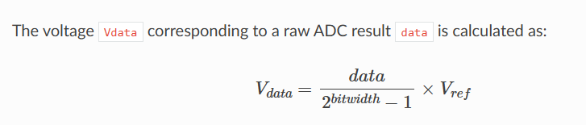

ADC może mierzyć wartości napięć do 1200mV (wartość Vref z dokumentacji)
Jezeli bysmy chcieli mierzyc wiecej trzeba uzywac attenuation na wejściu ale to chyba znaczy że lepiej nie używać tego attenuation jak nie musimy

Pool to wewnętrzny bufor (pewnie DMA) do zapisywania conversion results

-----do uzupełnienia - ilośc conversion frameów
ADC zapisuje każdy odczyt do CONVERSION RESULT, których konfigurowalna ilość wchodzi w skład jednego CONVERSION FRAME, definiowane w adc_digi_output_data_t. Czyli pewnie cały conversion frame będzie analizowany pod kątem tożsamości, bądź wiele frame'ów
---------------------------------------------------------------------------------

Output ma bitwidth od 9 do 13 bitów. Defaultowo 12
 - wzór na obliczenie natężenia uzyskanego z ADC, gdzie Vref
to 1000-1200mV, defaultowo 1100mV

Wybrano tryb ADC Continuous żeby próbkować z wysoką częstotliwością i w trybie ciągłym

@CEL projektu
Układ świeci diodą, pobiera wektor napięć z zacisków na fotorezystorze, wyświetla je na OLED display i przesyła po UARCIE

Funkcja ledFlicker_task sprawia ze dioda miga w okreslony sposob. Zasada działania: gdy dioda świeci, naciskamy palcem, gdy przestaje puszczamy. Zapewnia to powtarzalny pattern zasłaniania fotorezystora
